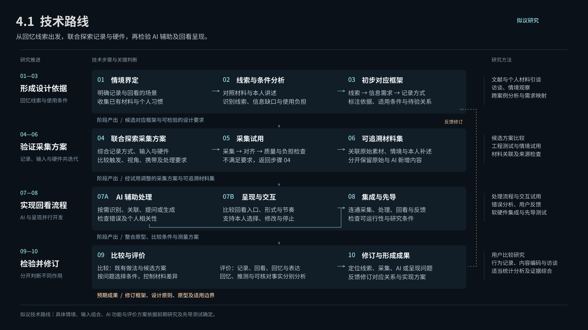

# 个人回忆唤起研究

硕士毕业论文与设计研究工作区。建立日期：2026-10-23。

暂定题目：**《面向个人回忆唤起的 AI 辅助生活记录与表达设计研究》**。

## 从这里开始

优先阅读 [研究上下文与接续](docs/00-研究上下文与接续.md)，了解当前决定、Figma 入口、未完成工作和资料边界（2026-10-30）。

**当前阶段（2026-10-30）：亲自精读文献，重建第二章。** 入口：[文献总表](docs/16-文献总表.md) · [第二章逻辑与精读方法](docs/17-第二章逻辑与精读方法.md) · 本地页面 `literature/文献精读台.html`。

2026-10-31 已将桌面服务器副本的最新工作及 PDF 缓存并入本目录，补齐原表中 19 篇待获取的 ACM 文献（18 篇新下载、1 篇关联已有 PDF）。当前 130 篇中本地已有 57 篇，仍缺 73 篇；详见[下载缺口清单](literature/当前文献下载缺口.md)。全文缓存仅保存在本机，获取全文不表示已精读。

1. [选题与研究框架](docs/01-选题与研究框架.md)：完整整理本次讨论形成的选题、研究问题、框架和任务。
2. [导师指导与上下文](docs/02-导师指导与上下文.md)：两次指导及三张截图的要点、依据和解释边界。
3. [长期记忆使用说明](docs/03-长期记忆使用说明.md)：如何开始新对话、维护记忆以及在另一台电脑恢复。

当前起点来自 2026-10-23 用户重新提供的材料与本轮确认。此前项目的名称、文献结论、框架和硬件方案不自动沿用。研究方向已接受；题目为暂定题目，框架是待研究完善的工作框架。

## 核心问题

如何依据个人的记录习惯与回忆方式，设计 AI 辅助的生活记录和内容呈现方式，使日常经历中有意义的线索得以保留，并在适当情境下激发个人回忆？

当前检索与整理规则见 [聚焦搜索与串联策略](docs/04-聚焦搜索与串联策略.md)：多领域搜索，按三个研究问题收敛整理。

当前阅读入口：[完整文献综述章节草稿](docs/05-文献综述.md)。本轮按用户要求扩大相关领域检索并形成连续论述；逐项核读层级与待获取全文见 [方法与核读边界](literature/review/综述方法与核读边界.md) 和 [引文核对表](literature/review/引文与证据核对表.md)。

综述末尾提出“线索—记录需求—AI 作用—呈现—评价”的候选对应关系；具体策略尚需用户研究和设计验证。

Figma 完整文字材料：[展开稿索引与分区入口](docs/08-Figma完整文字展开稿索引.md)。除连续综述外，已将选题、框架推导、研究方法与逐篇依据展开；新增的研究安排见 [研究框架与实施方案](docs/07-开题研究框架与实施方案.md)，均按拟议内容说明。原 17 页摘要保留为概览。

## 文件与记忆

- `docs/`：正式研究文档，纳入 Git 版本管理。
- `AGENTS.md`：本项目的工作规则与记忆入口，纳入 Git。
- `CLAUDE.md`：其他代理的兼容入口，纳入 Git。
- `.agents/skills/engramory/`：项目内协议及检查工具，纳入 Git。
- `.engramory-memory/`：本机唯一的项目代理记忆目录，已被 Git 忽略。

GitHub 仓库：[XuEimy/master-thesis](https://github.com/XuEimy/master-thesis)。远端状态以实时查询为准；目录改名不改变远端仓库名。

个人记忆不随 Git 克隆自动恢复。换机器时，先阅读本仓库文档，再按使用说明初始化并整理本机记忆；不要把“Git 已同步”理解为“本机记忆已备份”。

## 当前技术路线

[十步技术路线说明](docs/12-技术路线图-16比9.md) · [Figma 可编辑图](https://www.figma.com/design/R1Z5ryhzvwXJqO6ofxLgA3?node-id=191-2)

技术路线与框架尚待评议和验证。公开仓库保存整理后的上下文，不包含原始聊天、本机记忆及文献原文缓存；Figma 权限独立管理。
