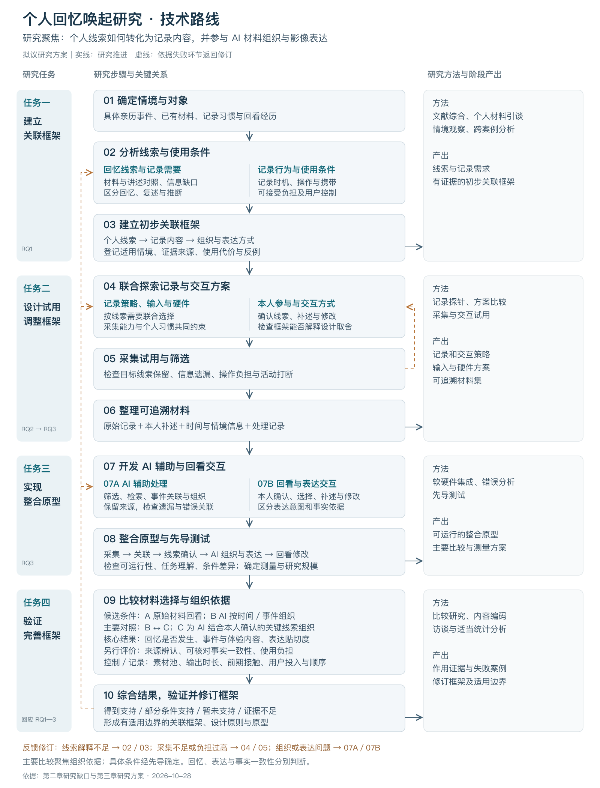

# 第四部分 实施路线与预期贡献

2026-10-28。承接 `docs/14-第三章研究内容与方法.md`。用户要求停止 PPT 制作，先完成内容；本稿不受单页字数限制。以下为拟开展的研究，不表示已有实证结果。研究主线为个人线索的保留与组织，主要比较方向为材料选择与组织依据；具体样本、设备及最终比较条件仍需先导研究确定。

## 4.1 怎样从研究问题推进到框架、原型与验证？——技术路线

[查看可编辑矢量图（SVG）](../outputs/technical-route/技术路线.svg)。下文为图的详细说明。

技术路线围绕四项任务展开：建立关联框架，通过记录与交互设计试用调整框架，实现软硬件整合原型，以及验证并完善框架。文献研究、个人材料分析、设计试用与比较评价分别提供不同依据。

### 第一阶段：识别个人线索，建立初步关联框架

先梳理第二章文献中的线索、记录行为、AI 辅助与结果变量，明确哪些关系已有依据，哪些仍需在个人材料中观察。随后开展个人材料引谈，结合具体经历了解参与者注意到什么、想起什么、哪些内容未被记录，以及为什么选择或放弃某种记录方式。

分析单位是一段具体亲历事件及其记录、讲述与回看过程。对照材料与本人解释，区分材料直接显示的信息、本人回忆、事后推断和无法确认的内容。跨案例分析后，提出“个人线索—记录内容—组织与表达方式”的候选对应关系，并写明适用情境、证据和反例。

阶段产出：个人线索与记录需求、带证据来源的初步关联框架。主要回应 RQ1。

### 第二阶段：通过记录与交互试用调整框架

依据候选线索明确需要留下的内容、前后联系及可接受的操作，再联合探索记录时机、输入组合、硬件形态和用户参与方式。通过小范围试用检查目标线索是否被保留、哪些内容遗漏，以及记录是否造成打断、负担或放弃。

交互试用同时考察本人怎样确认关键线索、补充材料和修改表达。若框架无法解释输入取舍，或某种记录代价过高，应返回对应关系调整。设备与输入服务于具体需要，不预先固定为全天连续录像或某种硬件。

阶段产出：修订后的关联框架、记录与交互策略、输入及硬件方案。主要回应 RQ2，并为 RQ3 提供材料和设计依据。

### 第三阶段：实现整合原型，完成先导测试

将采集、素材导入、事件关联、本人确认、AI 组织、影像表达和回看修改连接为可运行流程。AI 协助筛选和组织材料，本人确认个人关联与表达重点；分别保留原始记录、本人补述和 AI 新增内容的来源。

先导测试检查三个层面：工程上能否完成输入与处理，使用者能否理解任务并完成操作，以及比较条件是否真正形成差异。根据先导结果调整任务长度、材料要求、条件分配和评价方法，确定正式研究规模。

阶段产出：可运行的软硬件整合原型、明确的主要比较及测量方案。主要落实 RQ3。

### 第四阶段：比较材料组织方式，修订框架

主要比较因素为材料的选择与组织依据。候选条件包括原始材料直接回看、AI 按一般时间或事件规则组织，以及 AI 结合本人确认的关键线索组织。其中，后两者的比较用于考察个人线索参与组织的额外作用；原始回看作为参照。最终保留哪些条件，应围绕关键问题和可行规模确定。

尽量使用共同素材池，使界面、生成工具、输出时长和操作机会可比。特别记录线索确认过程的回忆影响与用户投入；若条件同时改变组织规则和用户参与，结果应解释为整体策略差异，不能全部归因于组织算法。

分别评价回忆是否发生、回忆的事件与体验内容、表达贴切度、来源辨认和使用负担。比较结果与访谈共同解释成功、失败及无变化案例，将框架关系修订为得到支持、仅在特定条件下支持、暂未支持或证据不足。

阶段产出：比较结果、修订框架、设计原则、整合原型及适用边界。

## 4.2 哪些问题最难解决，准备怎样处理？——研究重难点

### 个人线索怎样转成可以指导设计的关系？

同样的人物、声音或地点，对不同人、不同事件可能具有不同意义。不能把媒介分类直接当作个人线索分类，也不能用“后来想起来了”反向定义所有重要内容。

拟以具体事件开展材料引谈，记录本人解释、线索内容及其引出的讲述，再通过跨案例比较形成对应规则。每条规则保留个人条件、证据与反例，通过本人核对及设计试用检查其解释是否成立。

### 怎样在保留线索与减少记录负担之间取舍？

增加记录可能补足信息，也可能改变注意、干扰活动或降低持续使用意愿。素材数量增加不能直接说明记录更有效。

拟围绕目标线索检查信息保留和遗漏，同时记录操作次数、活动打断、补述与放弃。优先试用能够满足需要的输入组合，再根据缺失信息调整设备和记录策略。若原有记录已经足够，应保留原有方式。

### AI 怎样参与表达而不混淆内容来源？

AI 可能错误关联材料或补出没有依据的细节；用户认可画面表达，也不表示画面内容曾真实发生。

拟保留原始材料入口，分别标明原始记录、本人补述和 AI 新增表达。由本人确认关键关联并保留修改、拒绝及停止的权利。表达贴切度、主观准确感与可核对事实一致性分别评价。

### 怎样把组织方式的作用与其他因素区分开？

材料量、事件意义、用户投入和重复回看都会影响结果。若条件差异过多，即使发现变化，也难以解释变化来自哪里。

拟预先明确主要对照，使用共同素材池，并记录前期接触、操作投入及回看间隔。在先导中选择适合的条件分配和顺序安排；无法控制的差异进入分析与解释边界。主要研究不同时扩展为设备、生成风格和提示频率的多套优化实验。

### 怎样区分回忆、材料复述和推断？

用户说出的细节可能是刚从材料中看到的，也可能是重新想起的，或根据画面推断的；单看讲述长度或满意度无法判断。

拟结合初始讲述、材料接触后的补充与来源追问建立编码规则，分别登记材料信息、本人回忆、推断和不确定陈述。通过试编码修订歧义。新增细节、观看意愿、表达贴切度及事实一致性分别报告，不合并成一个笼统的“回忆效果”。

## 4.3 本研究拟增加什么贡献？——一个拟创新点

**建立并验证以个人线索为依据的“记录内容—影像表达”关联框架，使个人经历中的线索能够转化为具体的记录与组织决策。**

前文研究为回忆线索、记录行为、AI 辅助及影像表达分别提供依据。本研究拟进一步回答：对于某个人的一段具体经历，为什么需要保留某项内容，以及这项内容应怎样进入后续组织与表达。

该框架的基本单元是一条有条件的对应关系：在什么情境和回忆目的下，什么内容对本人具有线索意义，需要怎样记录，又适合怎样组织和表达。每条关系同时保留依据、用户参与、使用代价和不适用条件。

研究将通过记录试用、整合原型和材料组织比较检验这些对应关系，使框架既能说明设计取舍，也能依据失败案例被修订。框架、策略和原型是同一项拟创新的不同落实形式，不拆列为三项创新。其原创性及贡献程度仍需结合关键文献复核与实证结果判断。

## 4.4 最终论文怎样围绕这项研究展开？——论文提纲

以下为最终学位论文的拟定结构，与开题报告的章节组织有所区别。

### 第一章 绪论

1.1 研究背景与问题提出；1.2 研究目标与意义；1.3 研究对象、范围与核心概念；1.4 研究问题与任务；1.5 研究方法、技术路线与论文结构。

### 第二章 相关研究与研究问题

2.1 个人回忆与影像表达的相关研究；2.2 什么内容可能使本人想起经历；2.3 怎样把线索需要转成实际记录方式；2.4 AI 如何让记录参与回忆并帮助表达；2.5 内容怎样进入日常生活并引起回忆；2.6 已有研究还未解决哪些问题；2.7 综合已有研究，本研究需要回答什么问题。

2.7 先归纳前文研究中的变量与对应关系，再提出本论文研究问题；本论文的实验条件在研究设计部分确定。

### 第三章 个人材料研究与关联框架构建

3.1 研究设计与参与者；3.2 材料收集与引谈过程；3.3 个人线索、记录行为与信息缺口分析；3.4 关联框架与证据来源；3.5 设计需求、适用条件与待验证关系。

本章以实际材料形成框架，说明每条关系怎样得到，不只呈现一张框架图。

### 第四章 记录与交互设计及整合原型

4.1 框架向设计要求的转化；4.2 记录策略、输入组合与硬件试用；4.3 关键线索确认与 AI 材料组织；4.4 影像表达及回看修改交互；4.5 软硬件整合与来源追溯；4.6 先导测试与方案修订。

本章记录设计取舍、试用问题与修改依据，交代实际自动实现及人工辅助的范围。

### 第五章 比较研究与框架验证

5.1 主要比较因素、条件与研究设计；5.2 研究任务、过程与评价指标；5.3 回忆与表达结果；5.4 来源辨认、使用代价及失败案例；5.5 结果解释与关联框架修订；5.6 与已有研究对照及适用边界。

### 第六章 结论与展望

6.1 研究问题的回答；6.2 研究贡献与设计启示；6.3 研究局限；6.4 后续研究。

正文后附参考文献及必要附件，包括访谈提纲、编码说明、研究任务和材料来源记录规则。

## 4.5 各阶段什么时候完成，交付什么？——研究进度与计划

| 时间 | 主要工作 | 阶段交付 |
|---|---|---|
| 2026.10—11.05 | 收敛研究问题、文献变量和研究方案；完成开题报告及答辩准备 | 开题报告、技术路线与方法方案；11 月 5 日开题答辩 |
| 2026.11—12 | 开展个人材料引谈，分析线索、记录习惯及信息缺口 | 事件案例、编码与初步关联框架 |
| 2027.01 | 综合前期结果，开展早期记录和交互试用，明确主要比较 | 修订框架、设计要求与中期汇报材料 |
| 2027.02—03 | 调整输入与硬件，开发材料组织、影像表达与回看流程；开展先导测试 | 整合原型、比较条件和测量方案 |
| 2027.04—05 | 开展比较研究，分析回忆、表达、来源与使用代价 | 研究结果、失败案例及框架修订 |
| 2027.06 | 完成论文主体，接受导师审阅，准备送审并预留修改时间 | 论文稿、送审材料与完整研究记录 |
| 2027.07 | 按评阅意见修改论文，完善原型及成果展示，准备毕业答辩 | 论文定稿、设计成果和答辩材料 |

11 月 5 日开题答辩已由用户确认。其余为工作计划，中期、送审和毕业答辩日期依学院安排调整。文献补读、论文写作和资料整理贯穿各阶段。

## 4.6 参考文献

主要参考文献选列见下。编号沿用现有综述；完整题录、来源与核读边界以 `literature/review/citation-ledger.json` 和 `literature/review/引文与证据核对表.md` 为准。本次未新增文献全文或质量审计，不把选列题录等同于全部文献均已核实。

- 〔1〕Abigail J. Sellen; Steve Whittaker. 2010. Communications of the ACM. [Beyond total capture: a constructive critique of lifelogging](https://doi.org/10.1145/1735223.1735243)
- 〔3〕Martin A. Conway; Christopher W. Pleydell-Pearce. 2000. Psychological Review. [The construction of autobiographical memories in the self-memory system.](https://doi.org/10.1037/0033-295x.107.2.261)
- 〔4〕David C. Rubin. 2006. Perspectives on Psychological Science. [The Basic-Systems Model of Episodic Memory](https://doi.org/10.1111/j.1745-6916.2006.00017.x)
- 〔6〕Doménique van Gennip; Elise van den Hoven; Panos Markopoulos. 2015. Proceedings of the 33rd Annual ACM Conference on Human Factors in Computing Systems. [Things That Make Us Reminisce: Everyday Memory Cues as Opportunities for Interaction Design](https://doi.org/10.1145/2702123.2702460)
- 〔16〕Douglas Harper. 2002. Visual Studies. [Talking about pictures: A case for photo elicitation](https://doi.org/10.1080/14725860220137345)
- 〔19〕Nancy A. Van House. 2011. Visual Studies. [Personal photography, digital technologies and the uses of the visual](https://doi.org/10.1080/1472586x.2011.571888)
- 〔28〕Hongyan LIU; Yun ZHENG; Yaozhong LIU; Fei QIAO. 2023. Advances in Psychological Science. [The double-edged sword effect of consumers’ photo-taking behavior on consumption experience](https://doi.org/10.3724/sp.j.1042.2023.00480)
- 〔37〕Fabian Hutmacher; Beate Conrad; Markus Appel; Stephan Schwan. 2025. Cognitive Research: Principles and Implications. [Mediated autobiographical remembering in the digital age: insights from an experimental think-aloud study](https://doi.org/10.1186/s41235-025-00627-4)
- 〔43〕Shayan Talaei; Meijin Li; Kanu Grover; James Kent Hippler; Diyi Yang; Amin Saberi. 2025. Proceedings of the 38th Annual ACM Symposium on User Interface Software and Technology. [StorySage: Conversational Autobiography Writing Powered by a Multi-Agent Framework](https://doi.org/10.1145/3746059.3747681)
- 〔45〕Masayuki Ando; Kouyou Otsu; Tomoko Izumi. 2026. Transactions of the Japanese Society for Artificial Intelligence. [Memory Recall Support through Externalization of Remembered Scenes Using Generative AI: Evaluating the Effects of Iterative Image Modification Process](https://doi.org/10.1527/tjsai.41-3_a-p73)
- 〔48〕Vladimir Rosas; Rubén Dittus. 2021. Studies in Documentary Film. [The autobiographical documentary: archive and montage to represent the self](https://doi.org/10.1080/17503280.2020.1815123)
- 〔53〕Jason R. Finley; William F. Brewer. 2024. Memory. [Accuracy and completeness of autobiographical memory: evidence from a wearable camera study](https://doi.org/10.1080/09658211.2024.2377193)

## 封底文字

感谢聆听，敬请指正。

汇报人：徐亦民
